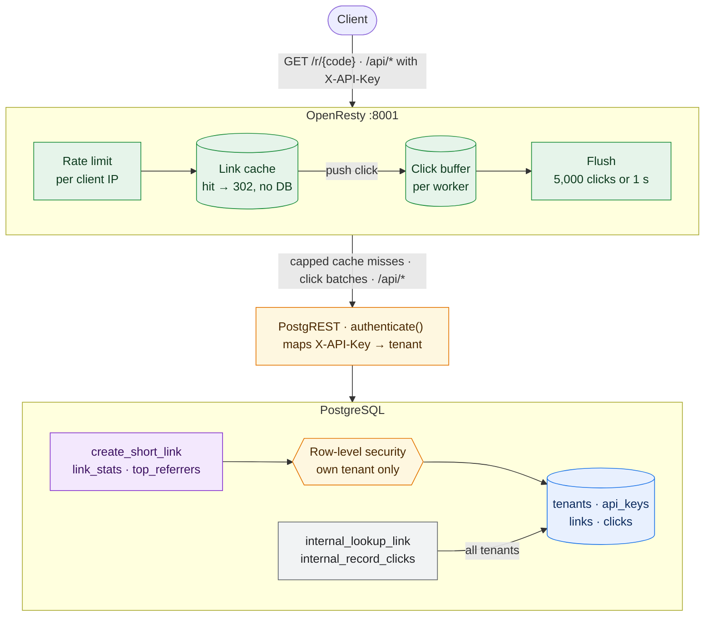
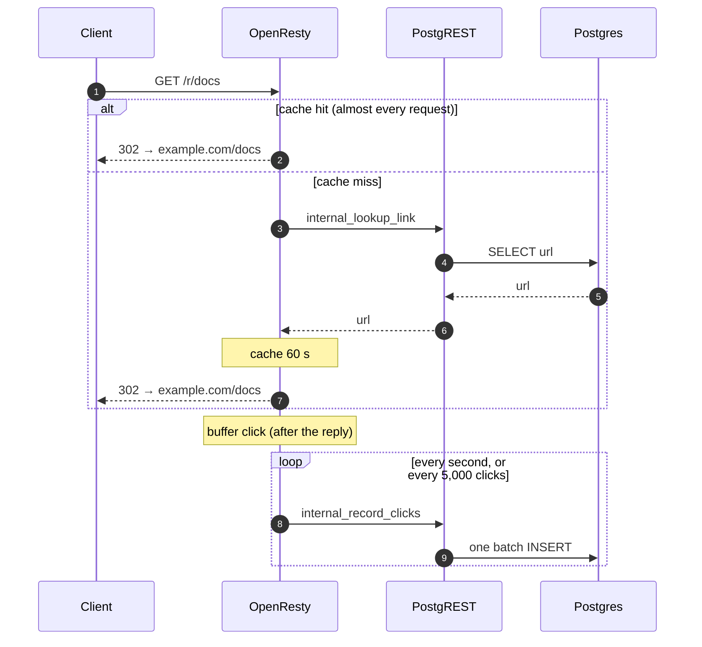

# ref_pg

A reference URL shortener that shows how far PostgreSQL plus a thin proxy can go. There is no application server. Postgres holds the data, the rules and the permissions. [PostgREST](https://postgrest.org) turns SQL functions and views into an HTTP API, and OpenResty (nginx + Lua) serves redirects from memory. Every claim below is backed by a test or a benchmark in this repo.



Redirects never wait for Postgres. A cache hit answers from memory, and the click is written later as part of a batch:



## What it shows off

- **The database is off the redirect path.** OpenResty caches code→URL in shared memory, and each worker buffers its clicks and writes them to Postgres in batches of up to 5,000. A redirect is a memory lookup: 529,000 req/s with a 2 ms p99. See [Benchmark](#benchmark).
- **Multi-tenancy is row-level security.** Each API key belongs to a tenant. A PostgREST pre-request hook (`authenticate()`) puts the tenant in the transaction, and one RLS policy per table scopes every read and write to it. Link creation runs as the caller (`SECURITY INVOKER`), so the policy applies there too.
- **Analytics are SQL views served for free.** `api.link_stats` and `api.top_referrers` are `security_invoker` views over rollup tables. A statement-level trigger keeps the rollups current on every click batch, so 10× the clicks doesn't mean 10× the query time (1 → 3 ms at 100k → 1M clicks). PostgREST serves the views with filtering, ordering and paging, and RLS scopes them per tenant. There is no endpoint code.
- **Retention without `DELETE`.** `clicks` is partitioned by UTC day. OpenResty calls a maintenance function every hour that attaches the coming week's partitions and drops days past `CLICK_RETENTION_DAYS`. Dropping 24 days under load took 12 ms and lost no clicks. A click for a day with no partition creates it on the spot.
- **Rules are constraints.** URLs must be `http(s)://`, and codes are 3–32 letters or digits. These are `CHECK` constraints, so no code path can skip them. Errors map to HTTP codes: `400` for an invalid value, `409` for a taken alias, `401` for a missing key, `403` for a non-admin key.
- **Privacy by default.** API keys are stored as SHA-256 hashes. Click IPs are cut to /24 (IPv4) or /48 (IPv6) before they are stored.
- **Degrades instead of failing.** When a cache entry expires, one request refreshes it while the rest keep getting the old URL. Unknown codes have their own cache, so a scan can't evict real links. Lookups waiting on Postgres are capped, and the overflow is shed with 503 instead of queueing. If Postgres stops answering, known links keep redirecting, a retried click batch is never counted twice, and a full click buffer costs clicks (counted), never redirects.
- **Tested in four layers.** 38 pgTAP tests check RLS, grants, rollups, partitioning, retention and every rule, with the code under test running as the real `anon` role. A 28-check HTTP smoke test runs against the full stack. A failure-mode test pauses PostgREST and floods a tiny click buffer. A chaos test runs a CPU- and RAM-limited stack through a stampede, a scan, a Postgres pause and 10× data, and asserts p99, request coalescing, exact click accounting, analytics scaling and retention under load. CI runs all four.

## Run it

```bash
cp .env.example .env    # set POSTGRES_PASSWORD and AUTHENTICATOR_PASSWORD
docker compose up -d --wait
```

Create a tenant and its first admin key (the only step that needs database access):

```bash
docker compose exec db sh -c 'psql -qAt -U "$POSTGRES_USER" -d "$POSTGRES_DB" -c "select issue_api_key('"'acme', 'admin', true"')"'
```

## API

Send the key in the `X-API-Key` header.

| Call | Key | Result |
|---|---|---|
| `POST /api/rpc/create_short_link` `{"p_original_url", "p_custom_alias"?}` | any | `{"code", "original_url"}` |
| `GET /r/{code}` | none | `302` to the URL, or `404` |
| `GET /api/link_stats` | any | per link: `clicks`, `clicks_24h`, `last_click_at` |
| `GET /api/top_referrers` | any | clicks per `code` and `referrer` |
| `POST /api/rpc/create_api_key` `{"p_name", "p_is_admin"?}` | admin | a new key for your tenant, shown once |
| `POST /api/rpc/revoke_api_key` `{"p_key"}` | admin | `true` if a key in your tenant was revoked |

```bash
curl -X POST localhost:8001/api/rpc/create_short_link \
  -H "Content-Type: application/json" -H "X-API-Key: $KEY" \
  -d '{"p_original_url": "https://example.com/docs", "p_custom_alias": "docs"}'

curl -i localhost:8001/r/docs

curl -H "X-API-Key: $KEY" 'localhost:8001/api/link_stats?order=clicks.desc&limit=10'
```

Views accept [PostgREST query syntax](https://docs.postgrest.org/en/v12/references/api/tables_views.html): `?code=eq.docs`, `?select=code,clicks`, `?order=clicks_24h.desc`.

Take down an abusive link: `update links set is_active = false where code = '...';`. Cached redirects keep working until the cache entry expires (`LINK_CACHE_SECONDS`, 60 by default).

## Test

```bash
RATE_LIMIT_REQUESTS=0 docker compose up -d --wait
docker compose exec -T db sh -c 'psql -X -q -At -U "$POSTGRES_USER" -d "$POSTGRES_DB"' < tests/db.sql
tests/smoke.sh
tests/resilience.sh    # restarts OpenResty and pauses PostgREST, then restores both
```

The chaos test runs on the limited stack and takes about 7 minutes:

```bash
RATE_LIMIT_REQUESTS=0 docker compose -f docker-compose.yml -f docker-compose.limits.yml up -d --build --wait
tests/chaos_bench.sh
```

## Benchmark

`GET /r/{code}` for one link, `wrk -t4 -c64 -d20s` run inside the Docker network, rate limiting and the access log off. Machine: Apple M4 Max (16 cores), Docker in OrbStack.

| Node | Requests/s | p50 | p99 | Clicks written/s |
|---|---:|---:|---:|---:|
| All 16 cores, no limits | **529,005** | 0.06 ms | 2.1 ms | 306,000 |
| Small node (`docker-compose.limits.yml`) | 212,224 | 0.27 ms | 1.5 ms | 111,000 |

Both runs offer more clicks than Postgres can take. The rest are dropped and counted, never lost silently: 6,127,276 recorded + 4,507,169 dropped = every redirect served (plus 42 in flight). Below that ceiling, nothing is dropped.

Run it: `RATE_LIMIT_REQUESTS=0 ACCESS_LOG=off docker compose up -d --wait && ./bench.sh`

Earlier versions of this README showed about 80,000 req/s with a 185 ms p99. That was macOS port forwarding into Docker, not ref_pg: `wrk` now runs inside the network. **[docs/performance.md](docs/performance.md)** maps every buffer, lock and throughput limit, and has the before/after results of the chaos test on a small node.

## Configuration

| Variable | Default | Purpose |
|---|---|---|
| `POSTGRES_PASSWORD` | required | Superuser password |
| `AUTHENTICATOR_PASSWORD` | required | PostgREST login. Letters and digits only (it goes into a URI) |
| `POSTGRES_USER`, `POSTGRES_DB` | `postgres`, `url_shortener` | |
| `PORT` | `8001` | Published OpenResty port |
| `RATE_LIMIT_REQUESTS`, `RATE_LIMIT_WINDOW` | `60`, `60` | Requests per window (seconds) per client IP. `0` turns limiting off |
| `TRUSTED_PROXIES` | empty | CIDRs of reverse proxies in front of OpenResty. Their `X-Forwarded-For` becomes the client IP. **Set this behind Coolify or Traefik**, or every client shares one rate limit |
| `LINK_CACHE_SECONDS` | `60` | How long a code→URL entry stays in memory. `0` turns the cache off |
| `LINK_NEGATIVE_CACHE_SECONDS` | `10` | How long an unknown code is remembered |
| `CLICK_FLUSH_SECONDS` | `1` | Click batch interval |
| `CLICK_RETENTION_DAYS` | `90` | Days of raw clicks to keep. `clicks` is partitioned by UTC day and older days are dropped hourly. `0` keeps everything. Link stats come from rollups and don't change |
| `CLICK_BUFFER` | `200000` | Clicks OpenResty may hold while Postgres is slow or down, across all workers. Size it as click rate × the stall to survive: 200,000 is 10 s at 20,000 clicks/s |
| `LOOKUP_CONCURRENCY` | `10` | Lookups allowed to wait on Postgres at once, across all workers. Past that, a cold miss gets 503. Worst-case wait = this ÷ lookups/s the node handles |
| `LINK_CACHE_MB`, `LINK_MISS_CACHE_MB` | `32`, `8` | Link cache (~130,000 links) and unknown-code cache (~65,000 codes) |
| `WORKER_PROCESSES` | `auto` | nginx workers. `auto` counts host cores, not a container CPU limit: set it to the CPU count you give the container |
| `LOG_LEVEL`, `ACCESS_LOG` | `notice`, `/dev/stdout` | nginx logging. `ACCESS_LOG=off` disables the access log |
| `CORS_ALLOW_ORIGIN` | `*` | |

## Layout

```
db/000_schema.sql          roles, tables, RLS, functions, views (runs once on an empty volume)
db/001_authenticator.sh    sets the PostgREST login password
docker/openresty/          nginx.conf (routes, rate limits), lua/links.lua (cache), lua/clicks.lua (click batching)
docker/postgres/           postgres:15 plus pgTAP
tests/db.sql               pgTAP tests
tests/smoke.sh             HTTP smoke test
tests/resilience.sh        failure modes: stampede, outage, full click buffer
tests/chaos_bench.sh       chaos test on the limited stack (with tests/chaos.lua, tests/loadgen/)
docker-compose.limits.yml  CPU and RAM limits of a small node
bench.sh                   wrk benchmark from inside the Docker network
docs/performance.md        buffers, locks and throughput limits, with measurements
```

## Known limitations

- **Clicks are buffered in memory.** A crash (not a normal stop) loses the clicks still in the buffer, up to about one flush interval. If Postgres is down, clicks wait in the buffer (`CLICK_BUFFER`, 200,000 by default); after that they are dropped and counted in one log line per worker per second.
- **`clicks_24h` counts whole hours:** the current hour plus the 23 before it.
- **Retention is by whole UTC days.** Raw clicks older than `CLICK_RETENTION_DAYS` go away a day at a time. Plan disk for about 130 bytes per click: 90 days at 1,000 clicks/s is about 1 TB.
- **`top_referrers` is all-time,** so its daily rollup is never pruned. It grows with links × days × distinct referrers.
- **During a Postgres outage, cached links keep their last known URL.** That includes a link taken down just before the outage.
- **Referrer and user agent are stored as printable ASCII only.** Other bytes are stripped before a click is queued, because one invalid UTF-8 byte would make Postgres reject a whole batch.
- **Each OpenResty instance has its own cache.** That's fine for one instance. With several, a takedown takes up to `LINK_CACHE_SECONDS` to reach all of them.
- **`db/` runs once.** It initializes an empty volume. For a database with data in it, apply schema changes with `psql` by hand. Add a migration tool when that becomes painful.

## License

MIT
