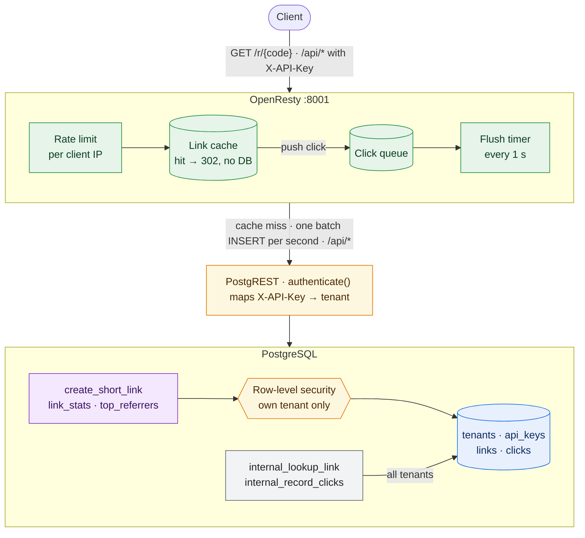
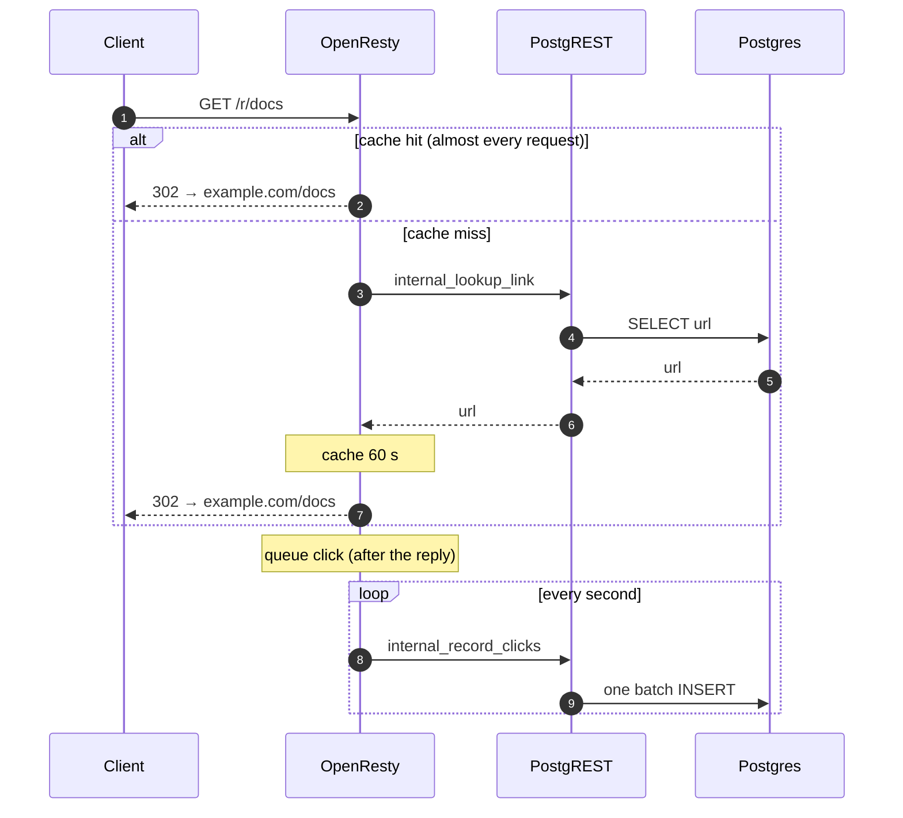

# ref_pg

A reference URL shortener that shows how far PostgreSQL plus a thin proxy can go. There is no application server. Postgres holds the data, the rules and the permissions. [PostgREST](https://postgrest.org) turns SQL functions and views into an HTTP API, and OpenResty (nginx + Lua) serves redirects from memory. Every claim below is backed by a test or a benchmark in this repo.



Redirects never wait for Postgres. A cache hit answers from memory, and the click is written later as part of a batch:



## What it shows off

- **The database is off the redirect path.** OpenResty caches code→URL in a `lua_shared_dict` and queues clicks in memory. One timer writes them to Postgres as a single batch insert every second. A redirect is a memory lookup. See [Benchmark](#benchmark).
- **Multi-tenancy is row-level security.** Each API key belongs to a tenant. A PostgREST pre-request hook (`authenticate()`) puts the tenant in the transaction, and one RLS policy per table scopes every read and write to it. Link creation runs as the caller (`SECURITY INVOKER`), so the policy applies there too.
- **Analytics are SQL views served for free.** `api.link_stats` and `api.top_referrers` are plain views with `security_invoker`. PostgREST serves them with filtering, ordering and paging, and RLS scopes them per tenant. There is no endpoint code.
- **Rules are constraints.** URLs must be `http(s)://`, and codes are 3–32 letters or digits. These are `CHECK` constraints, so no code path can skip them. Errors map to HTTP codes: `400` for an invalid value, `409` for a taken alias, `401` for a missing key, `403` for a non-admin key.
- **Privacy by default.** API keys are stored as SHA-256 hashes. Click IPs are cut to /24 (IPv4) or /48 (IPv6) before they are stored.
- **Degrades instead of failing.** When a cache entry expires, one request refreshes it while the rest keep getting the old URL. If Postgres stops answering, known links keep redirecting from memory, unknown codes fail in 2 s instead of hanging, and a full click queue costs clicks, never redirects.
- **Tested in three layers.** 25 pgTAP tests check RLS, grants and every rule, with the code under test running as the real `anon` role. A 28-check HTTP smoke test runs against the full stack. A failure-mode test pauses PostgREST and floods a tiny click queue. CI runs all three on every push.

## Run it

```bash
cp .env.example .env    # set POSTGRES_PASSWORD and AUTHENTICATOR_PASSWORD
docker compose up -d --wait
```

Create a tenant and its first admin key (the only step that needs database access):

```bash
docker compose exec db sh -c 'psql -qAt -U "$POSTGRES_USER" -d "$POSTGRES_DB" -c "select issue_api_key('"'acme', 'admin', true"')"'
```

## API

Send the key in the `X-API-Key` header.

| Call | Key | Result |
|---|---|---|
| `POST /api/rpc/create_short_link` `{"p_original_url", "p_custom_alias"?}` | any | `{"code", "original_url"}` |
| `GET /r/{code}` | none | `302` to the URL, or `404` |
| `GET /api/link_stats` | any | per link: `clicks`, `clicks_24h`, `last_click_at` |
| `GET /api/top_referrers` | any | clicks per `code` and `referrer` |
| `POST /api/rpc/create_api_key` `{"p_name", "p_is_admin"?}` | admin | a new key for your tenant, shown once |
| `POST /api/rpc/revoke_api_key` `{"p_key"}` | admin | `true` if a key in your tenant was revoked |

```bash
curl -X POST localhost:8001/api/rpc/create_short_link \
  -H "Content-Type: application/json" -H "X-API-Key: $KEY" \
  -d '{"p_original_url": "https://example.com/docs", "p_custom_alias": "docs"}'

curl -i localhost:8001/r/docs

curl -H "X-API-Key: $KEY" 'localhost:8001/api/link_stats?order=clicks.desc&limit=10'
```

Views accept [PostgREST query syntax](https://docs.postgrest.org/en/v12/references/api/tables_views.html): `?code=eq.docs`, `?select=code,clicks`, `?order=clicks_24h.desc`.

Take down an abusive link: `update links set is_active = false where code = '...';`. Cached redirects keep working until the cache entry expires (`LINK_CACHE_SECONDS`, 60 by default).

## Test

```bash
RATE_LIMIT_REQUESTS=0 docker compose up -d --wait
docker compose exec -T db sh -c 'psql -X -q -At -U "$POSTGRES_USER" -d "$POSTGRES_DB"' < tests/db.sql
tests/smoke.sh
tests/resilience.sh    # restarts OpenResty and pauses PostgREST, then restores both
```

## Benchmark

`GET /r/{code}` for one hot link, `wrk -t4 -c64 -d20s`, rate limiting off (`RATE_LIMIT_REQUESTS=0`), nothing else changed between runs.

| Setup | Requests/s | p50 | p99 |
|---|---:|---:|---:|
| Before: one synchronous `INSERT` per click | 714 | 79 ms | 319 ms |
| Clicks batched, cache off (`LINK_CACHE_SECONDS=0`) | 5,766 | 10.2 ms | 37 ms |
| Clicks batched, cache on (default) | **80,578** | **0.65 ms** | 185 ms |

No clicks are lost under that load. In the cache-on run, `wrk` counted 1,611,594 completed redirects and Postgres recorded 1,611,652 clicks. The 58 extra are requests still in flight when `wrk` stopped (it had 64 connections open). `bench.sh` prints both numbers. Machine: Apple M4 Max (16 cores), Docker in OrbStack 2.2.4. `wrk` and all three containers share that machine, so treat the numbers as relative. Across repeated runs, cache-off throughput varied between about 5,000 and 6,000 req/s, and cache-on stayed near 80,000. The cache-on p99 is much higher than its p50. That tail hasn't been profiled yet: likely suspects are the click flush running on worker 0 and the machine being saturated.

Run it yourself: `RATE_LIMIT_REQUESTS=0 docker compose up -d --wait && ./bench.sh`

## Configuration

| Variable | Default | Purpose |
|---|---|---|
| `POSTGRES_PASSWORD` | required | Superuser password |
| `AUTHENTICATOR_PASSWORD` | required | PostgREST login. Letters and digits only (it goes into a URI) |
| `POSTGRES_USER`, `POSTGRES_DB` | `postgres`, `url_shortener` | |
| `PORT` | `8001` | Published OpenResty port |
| `RATE_LIMIT_REQUESTS`, `RATE_LIMIT_WINDOW` | `60`, `60` | Requests per window (seconds) per client IP. `0` turns limiting off |
| `TRUSTED_PROXIES` | empty | CIDRs of reverse proxies in front of OpenResty. Their `X-Forwarded-For` becomes the client IP. **Set this behind Coolify or Traefik**, or every client shares one rate limit |
| `LINK_CACHE_SECONDS` | `60` | How long a code→URL entry stays in memory. `0` turns the cache off |
| `LINK_NEGATIVE_CACHE_SECONDS` | `10` | How long an unknown code is remembered |
| `CLICK_FLUSH_SECONDS` | `1` | Click batch interval |
| `CLICK_QUEUE_MB` | `64` | Click queue size, about 2,000 clicks per MB. Sets how long a Postgres outage can last before clicks are dropped |
| `LOG_LEVEL`, `ACCESS_LOG` | `notice`, `/dev/stdout` | nginx logging. `ACCESS_LOG=off` disables the access log |
| `CORS_ALLOW_ORIGIN` | `*` | |

## Layout

```
db/000_schema.sql          roles, tables, RLS, functions, views (runs once on an empty volume)
db/001_authenticator.sh    sets the PostgREST login password
docker/openresty/          nginx.conf (routes, rate limits), lua/links.lua (cache), lua/clicks.lua (click batching)
docker/postgres/           postgres:15 plus pgTAP
tests/db.sql               pgTAP tests
tests/smoke.sh             HTTP smoke test
tests/resilience.sh        failure modes: stampede, outage, full click queue
bench.sh                   wrk benchmark
```

## Known limitations

- **Clicks are buffered in memory.** A crash (not a normal stop) loses up to `CLICK_FLUSH_SECONDS` of clicks. If Postgres is down, clicks wait in the queue (about 130,000 at the default 64 MB, which is 1.6 s at 80,000 req/s). After that they are dropped and counted in one log line per flush.
- **During a Postgres outage, cached links keep their last known URL.** That includes a link taken down just before the outage.
- **Referrer and user agent are stored as printable ASCII only.** Other bytes are stripped before a click is queued, because one invalid UTF-8 byte would make Postgres reject a whole batch.
- **Each OpenResty instance has its own cache.** That's fine for one instance. With several, a takedown takes up to `LINK_CACHE_SECONDS` to reach all of them.
- **`db/` runs once.** It initializes an empty volume. For a database with data in it, apply schema changes with `psql` by hand. Add a migration tool when that becomes painful.

## License

MIT
